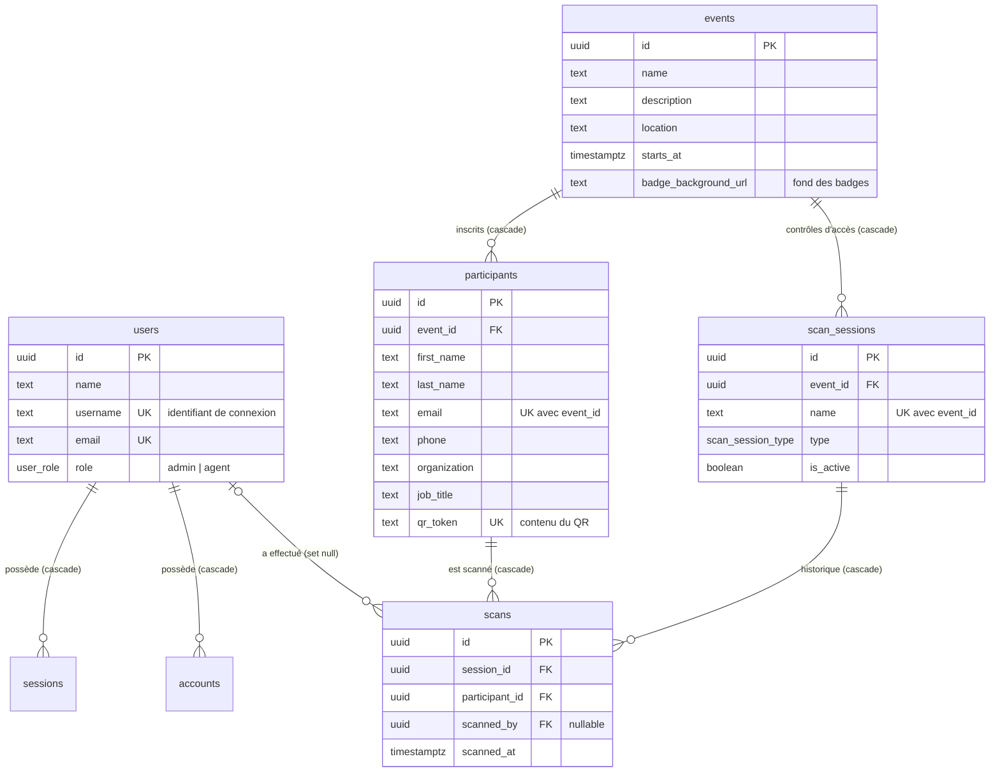
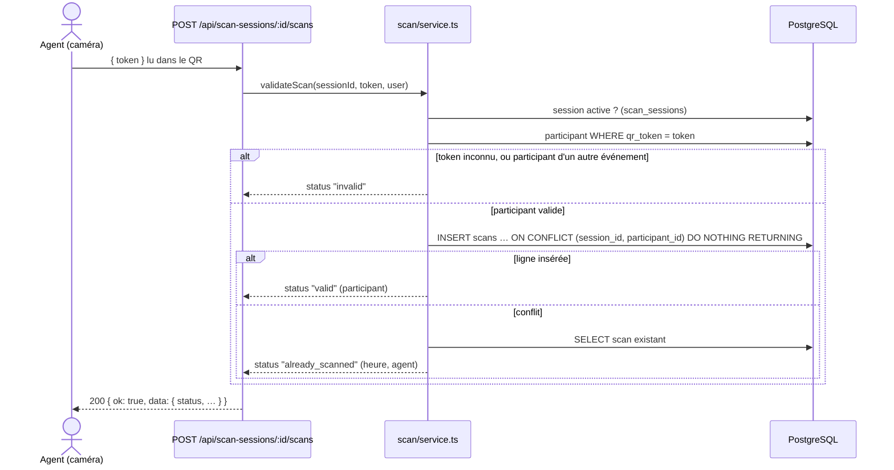

# Base de données

PostgreSQL + Drizzle ORM. Source de vérité : [`src/db/schema.ts`](../src/db/schema.ts). Migrations : `src/db/migrations/` (générées, jamais modifiées à la main).

> **Le schéma est un fichier sensible.** Toute modification (colonne, index, contrainte) passe par le project lead, puis `pnpm db:generate` et commit de la migration générée. Ne jamais éditer une migration déjà mergée.

## Diagramme entité-relation



Les tables `sessions`, `accounts` et `verifications` (authentification) sont décrites plus bas ; `verifications` n'a aucun lien avec les autres.

## Conventions

- **Identifiants** : `uuid` générés par PostgreSQL (`gen_random_uuid()`). Dans l'API ce sont des chaînes UUID.
- **Noms** : tables au pluriel en `snake_case`, colonnes en `snake_case`. Dans le code TypeScript on écrit `scanSessions.eventId` : Drizzle convertit (option `casing: "snake_case"`).
- **Dates** : `timestamptz` (UTC). Toutes les tables ont `created_at` ; `updated_at` est mis à jour automatiquement par Drizzle lors d'un `update`.
- **Emails** : le service les normalise en **minuscules** avant insertion.
- **Imports dans `src/db/`** : relatifs (`../lib/…`), car `drizzle-kit` ne résout pas l'alias `@/`.

## Tables

### `users` — comptes de l'application

Administrateurs et agents de scan. Colonnes de base compatibles Better Auth.

| Colonne             | Rôle                                                          |
| ------------------- | ------------------------------------------------------------- |
| `username` (unique) | Identifiant de connexion                                      |
| `email` (unique)    | Exigé par Better Auth. Peut être fictif (`agent1@club.local`) |
| `role`              | `admin` (tout) ou `agent` (scan et consultation)              |

### `sessions`, `accounts`, `verifications` — authentification

Gérées par Better Auth (étape 5), **à ne pas manipuler à la main** dans les features.
`accounts.password` contient le **hash** du mot de passe (`providerId = "credential"`). Supprimer un utilisateur supprime en cascade ses sessions et comptes.

### `events` — événements

Nom, description, lieu, date de début (`starts_at`).
`badge_background_url` : URL (stockage fichiers) de l'image de fond des badges de l'événement ; `NULL` = badge par défaut. C'est tout ce que prévoit le schéma pour les badges.

### `participants` — inscrits à un événement

Rattaché à un événement. `organization` et `job_title` correspondent à « organisation / fonction ».

- **`qr_token`** : unique (index unique), généré automatiquement à l'insertion par `generateQrToken()` (`src/lib/tokens.ts`) : 32 caractères base64url issus de 192 bits aléatoires cryptographiques. Non devinable ; le QR code encode **ce token**, jamais l'`id`.
- **Unicité `(event_id, lower(email))`** : un même email ne peut pas être inscrit deux fois à un événement (insensible à la casse). C'est ce qui détecte les doublons à l'import Excel (erreur Postgres `23505`).
- Index `(event_id, last_name)` pour la liste triée et la recherche.

### `scan_sessions` — sessions de scan

Un point de contrôle d'un événement : « Entrée principale », « Déjeuner », « Atelier IA »…

- `type` : `entrance | meal | workshop | vip | other` (aide l'affichage, n'a pas d'effet métier).
- `is_active` : une session fermée refuse les nouveaux scans mais conserve son historique.
- Unicité `(event_id, name)`.

### `scans` — historique des scans

Une ligne = « ce participant a été validé dans cette session, par cet utilisateur, à cette heure ».

- **Unicité `(session_id, participant_id)`** : un participant n'est scanné qu'**une seule fois par session**.
- `scanned_by` : l'agent (ou admin) qui a scanné. Si ce compte est supprimé plus tard, la valeur passe à `NULL` mais **le scan reste** dans l'historique.
- `scanned_at` : horodatage serveur.

## Suppression en cascade

```
events ──► participants ──► scans
       └─► scan_sessions ──► scans
users  ──► sessions, accounts            (scans.scanned_by passe à NULL, pas de suppression)
```

Supprimer un événement supprime ses participants, ses sessions de scan et tous les scans associés. Supprimer un participant ou une session supprime ses scans.

## Détection des doublons de scan

Le doublon est détecté **par la base**, pas par un « select puis insert » (qui est vulnérable à deux scans simultanés). Le service `scan` fait un `INSERT … ON CONFLICT DO NOTHING RETURNING` : si rien n'est retourné, le participant avait déjà été scanné et on relit le scan existant pour répondre « déjà scanné » (avec l'heure et l'agent d'origine).



## Règles qui ne sont PAS garanties par la base

À vérifier dans les services :

1. **Cohérence événement** : le participant scanné doit appartenir au **même événement** que la session de scan (aucune clé étrangère ne l'impose). Sinon répondre « invalide ».
2. **Session active** : refuser les scans quand `is_active = false`.
3. **Normalisation** : emails en minuscules, espaces retirés (`trim`).
4. **Tentatives en doublon** : elles sont _détectées_ (réponse « déjà scanné ») mais **pas enregistrées**. Il n'existe pas de table de tentatives ; à ajouter seulement si le besoin apparaît.

## Seed (`pnpm db:seed`)

Données de développement (efface d'abord les données existantes ; **refusé en production**) :

- 2 comptes : `admin` (admin) et `agent` (agent). Mots de passe : `SEED_ADMIN_PASSWORD` / `SEED_AGENT_PASSWORD`, sinon `Admin123!` / `Agent123!`.
- 2 événements, **30 participants** (20 et 10) avec organisations et fonctions variées.
- 3 sessions : « Entrée principale » et « Déjeuner » (événement 1), « Accueil conférence » (événement 2).
- 21 scans répartis entre l'admin et l'agent.

La commande affiche à la fin un token scanné et un token non scanné pour tester l'API de scan.
